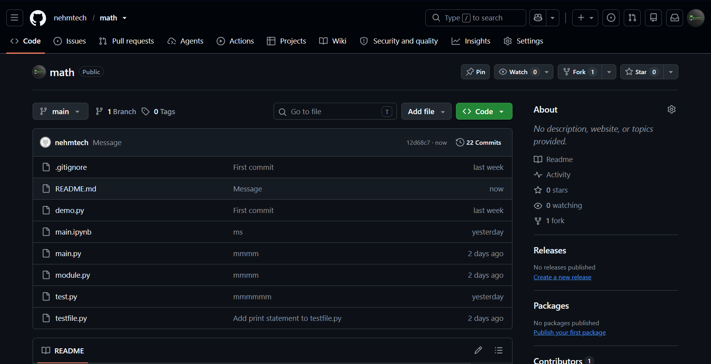

# Heading 1
## Heading 2
### Heading 3
#### Heading 4
##### Heading 5
###### Heading 6

---

**Bold text**

---

*Italic text*

---

~~Strike~~

---

`print("Hello world")`

---

> This is a quote

> This is a quote

> This is a quote

---
- Unordered list 1
- Unordered list 2
- Unordered list 3
- Unordered list 4

---
1. ordered list 1
2. ordered list 2
3. ordered list 3
4. ordered list 4

---

- [ ] Pending

- [x] Task done

---

[This is a link](https://www.google.com)

---



---

```python
a = 100
b = 200
print(a + b)
```

---

| name           | email              |
|----------------|--------------------|
| James Smith    | info@example.com   |
| Tom and Jerry  |  example@gmail.com |


---

\* Italic text \*

\- Italic text 

This is a long paragrapjjjjjhhhh